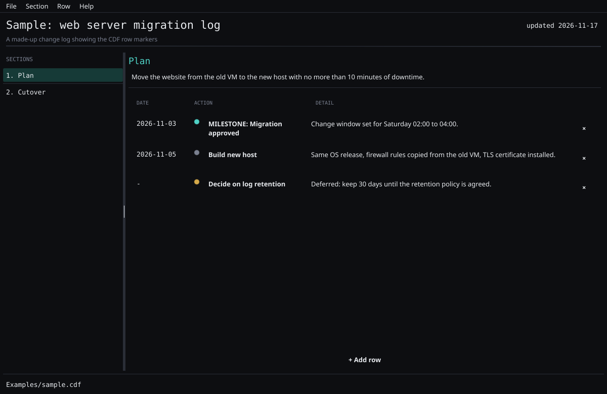

# CDF (ClaudeDocFormat)

CDF is a small document format for operational notes, change logs, runbooks and status reports: anything that is mostly dated rows in sections. A `.cdf` file is plain, pretty-printed JSON, so it diffs cleanly in git, works with `jq`, and never locks you into an app.

This repo has three parts:

| Part | What it is |
|------|------------|
| `cdf` | Terminal viewer and editor (one Bun script, compiles to a single binary) |
| `cdf-gui` | Desktop viewer and editor for Linux and Windows (Go + Fyne) |
| `spec.md` | The file format, version 1 |



## Install

Download from the [latest release](https://github.com/kcherry497/cdf/releases/latest). Check the files against `SHA256SUMS` from the same release.

### Ubuntu / Debian (x86_64)

The `.deb` installs both programs, the `.cdf` file type, the icon and a "CDF Viewer" menu entry.

```bash
sudo apt install ./cdf_1.0.1_amd64.deb
```

Then double-click any `.cdf` file, or run `cdf-gui file.cdf` (desktop) or `cdf file.cdf` (terminal). File > Open uses the native GTK file dialog when `zenity` is installed (`sudo apt install zenity`).

To remove it: `sudo apt remove cdf`.

### Windows 10 / 11 (x64)

Run `cdf-viewer-1.0.1-setup.exe`. It installs CDF Viewer under Program Files, adds Start Menu and (optionally) Desktop shortcuts, and makes `.cdf` files open in CDF Viewer. Uninstall it from Settings > Apps.

The installer is not code-signed, so SmartScreen may warn "Windows protected your PC". Click **More info**, then **Run anyway**.

### Terminal tool only (Linux, macOS, Windows)

With [Bun](https://bun.sh) installed:

```bash
# run without installing
bun Tools/cdf.ts file.cdf

# or build a standalone binary and put it on your PATH
bun build --compile Tools/cdf.ts --outfile ~/.local/bin/cdf
```

Bun can cross-compile with `--target=bun-linux-x64`, `bun-darwin-arm64`, `bun-windows-x64` and so on.

## Use

### Terminal (`cdf`)

```
cdf file.cdf              open in the viewer/editor
cdf new "Title"           print a skeleton document to stdout
cdf validate file.cdf     check the schema (exit 0 ok, 1 fail)
cdf export file.cdf       print a self-contained HTML copy to stdout
```

In the viewer: arrow keys move, Enter edits the cell in `$EDITOR`, `a` adds a row, `d` deletes a row, `A` / `D` add or delete a section, `s` saves, `q` quits, `?` shows every key.

### Desktop (`cdf-gui`)

Click a cell to edit it. Ctrl+N new, Ctrl+O open, Ctrl+S save, Ctrl+Shift+S save as, Ctrl+E export HTML.

### Sharing with someone who has neither

`cdf export file.cdf > file.html` (or File > Export HTML in the GUI) makes a read-only, dark-theme HTML page with no dependencies.

## The format in one minute

```json
{
  "meta": { "cdf_version": 1, "title": "Change log", "updated": "2026-11-17" },
  "sections": [
    {
      "id": "cutover",
      "name": "Cutover",
      "rows": [
        { "date": "2026-11-08", "action": "MILESTONE: DNS switched", "detail": "TTL lowered two days earlier." },
        { "date": "-", "action": "Decide on log retention" }
      ]
    }
  ]
}
```

Each row's marker comes from its text: `MILESTONE:` is teal, `EXPOSURE:` is red, a date of `-` is amber (deferred), and anything else is plain. Extra fields are kept when the file is saved. The full rules are in [spec.md](spec.md); [Examples/sample.cdf](Examples/sample.cdf) shows every marker.

## Build from source

`dist/build.sh` builds everything into `dist/out/`: `cdf`, `cdf-gui`, the `.deb`, the Windows installer and `SHA256SUMS`.

Requirements on Ubuntu 22.04 or later:

```bash
sudo apt install golang gcc libgl1-mesa-dev xorg-dev dpkg-dev \
                 gcc-mingw-w64-x86-64 nsis        # the last two only for the Windows build
curl -fsSL https://bun.sh/install | bash
```

Go 1.22 or later is required (Fyne uses cgo, hence `gcc`).

```bash
dist/build.sh                     # version 1.0.1
VERSION=1.0.2 dist/build.sh       # another version
```

To build just the Linux GUI: `cd GUI && go build -trimpath -buildvcs=false -o cdf-gui .`

## Using it with Claude Code

`SKILL.md` is a [Claude Code](https://claude.com/claude-code) skill. Copy this folder to `~/.claude/skills/CDF/` and Claude will write and read `.cdf` files when you ask it to "make a cdf" or save a table-shaped answer.

## License

[MIT](LICENSE)
